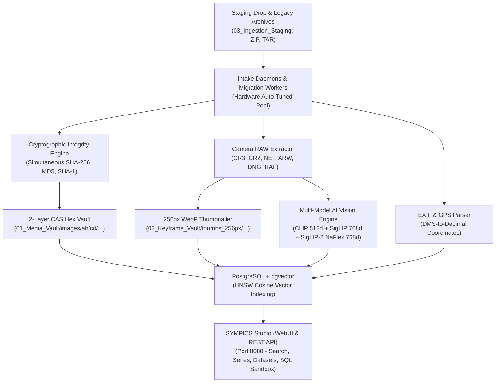

# SYMPICS Intelligent Media & Correlation Platform

SYMPICS is an enterprise-grade digital media ingestion, multi-model AI vision search, and Content-Addressed Storage (CAS) vault platform designed for high-throughput asset triage, multi-modal search, and large-scale media archives.

---

## [*] Key Architecture & Features



* **Multi-Model AI Vision Search:** Tri-vector semantic embedding using **CLIP ViT-B/32 (512d)**, **SigLIP Base (768d)**, and **SigLIP-2 NaFlex (768d)** with PostgreSQL `pgvector` HNSW indexes.
* **Content-Addressed Storage (CAS):** Strict 2-layer hex directory partitioning (`01_Media_Vault/images/xx/yy/<sha256>.ext`) preventing directory scale degradation and enabling bit-for-bit deduplication.
* **Camera RAW Support:** Pure-Python in-stream embedded preview extraction for Canon (`.CR3`, `.CR2`), Nikon (`.NEF`), Sony (`.ARW`), Adobe (`.DNG`), and Fuji (`.RAF`) camera RAW files in ~200ms.
* **Dynamic Hardware Auto-Scaling:** Auto-detects NVIDIA CUDA GPU VRAM, Apple Silicon MPS, or multi-core CPUs and auto-tunes worker pools and batch sizes.
* **Security Hardening:** Read-only transaction isolation for SQL Explorer, AST destructive command blocking, Zip Slip directory traversal defenses, and CORS origin restrictions.
* **Anti-Bit Rot Scrubbing:** Background cryptographic scrubber (`sympics-scrubber`) validating physical files against stored SHA-256 ledgers.

---

## Repository Structure

```text
image-correlation-suite/
├── sympics/                             # Root Python package (installable via pip install -e .)
│   ├── core/                          # Hashing, CAS vaulting, EXIF/GPS, RAW extraction, Archive security
│   ├── ai/                            # Multi-model vision embedder & 256px WebP thumbnailer
│   ├── database/                      # Connection pooling & pgvector operations
│   ├── daemons/                       # Persistent background intake watchers
│   ├── migration/                     # Discovery scanner & high-speed ingestion workers
│   └── web/                           # REST API & static streaming server
│
├── database/                          # SQL DDL schemas and database utilities
├── scripts/
│   ├── daemons/                       # SYMPICS staging intake daemon
│   ├── filesystem-migration/          # 4-phase legacy manifest scanner & worker
│   └── maintenance/                   # Vault integrity & anti-bit rot scrubber
│
├── web/                               # Web frontend UI (HTML/CSS/JS) & REST API server
├── tests/                             # Automated test suite (unit & integration with pytest)
├── systemd/                           # Enterprise systemd service templates
├── pyproject.toml                     # Python package build specifications (PEP 517/621)
├── setup.py                           # Setuptools package installer
├── .pre-commit-config.yaml            # Pre-commit linting & security hook configurations
└── .env.example                       # Environment variables configuration template
```

---

## Quickstart

### 1. Installation

* **Windows Systems (Automated Setup):** Open PowerShell as Administrator and run:
  ```powershell
  Set-ExecutionPolicy Bypass -Scope Process -Force
  .\scripts\windows\setup_windows_prerequisites.ps1
  ```
  *(See [Windows Setup Guide](docs/05_windows_workstation_setup_guide.md) for full walkthrough).*

* **Linux / macOS Systems:**
  ```bash
  # Clone the repository and install editable package
  git clone <internal-repo-url> image-correlation-suite
  cd image-correlation-suite
  pip install -e .
  python3 database/init_database.py
  ```

### 2. Run Tests
```bash
pytest -v
```

### 3. Start Web UI & REST API Server (Port 8080)
* **Windows (1-Click):** Double-click `start_studio.bat` (starts server and opens `http://localhost:8080`).
* **Windows 24/7 Supervisor Service:** Right-click `scripts\windows\install_windows_supervisor_task.bat` and run as Admin (auto-restarts web & intake daemons if they ever crash).
* **Linux / macOS:**
  ```bash
  python3 web/server.py
  ```

### 4. Run Vault Ingestion & Migration
* **Windows (1-Click Launchers):**
  1. `build_vault.bat` — Pre-allocates 65,536 hex buckets in `future-lan-storage`.
  2. `scan_manifest.bat` — Phase 1 100% read-only discovery scan.
  3. `migrate_vault.bat` — Phase 2 supervised parallel AI embedding & verified CAS copy.
* **Linux / macOS:**
  ```bash
  # Pre-allocate CAS vault buckets
  python3 scripts/filesystem-migration/build_hex_vault_structure.py -t future-lan-storage

  # Phase 1: Read-Only Discovery Scan
  python3 scripts/filesystem-migration/scan_legacy_manifest.py -s future-lan-storage/03_Ingestion_Staging

  # Phase 2: Supervised Parallel Ingestion (Auto-scales across CPU/GPU)
  python3 scripts/filesystem-migration/migrate_vault_worker.py -v future-lan-storage
  ```

### 5. Clean Slate Protocol (System Reset)
To clear all indexed media records and reset the storage directories to an initial pristine state:
* **Windows (1-Click):** Double-click `scripts\clean-slate\run_clean_slate.bat` (includes confirmation safety check).
* **Linux / macOS:**
  ```bash
  python3 scripts/clean-slate/clean_slate_protocol.py
  ```

### 6. Run Vault Integrity Scrubber
```bash
python3 scripts/maintenance/scrub_vault_integrity.py
```

---

## AI Vision Models & Air-Gapped Deployment

SYMPICS utilizes a multi-model ensemble for semantic and crop similarity search. When operating in an air-gapped environment without internet access, pre-download the weights using the automated provisioning tool:

### 1. Download Model Weights (on an internet-connected machine)
```bash
# Download all models into ./models
python3 scripts/maintenance/download_offline_models.py --target-dir ./models --models all

# Or package directly into a portable archive for USB/LAN transfer:
python3 scripts/maintenance/download_offline_models.py --create-tar sympics-offline-models.tar.gz
```

### 2. Supported Model Registry

| Model | Hugging Face Repository | Dimension | License | Access |
| :--- | :--- | :---: | :--- | :--- |
| **SigLIP Base** | [`google/siglip-base-patch16-224`](https://huggingface.co/google/siglip-base-patch16-224) | 768-dim | Apache 2.0 | Open Access |
| **SigLIP-2 NaFlex** | [`google/siglip2-base-patch16-naflex`](https://huggingface.co/google/siglip2-base-patch16-naflex) | 768-dim | Apache 2.0 | Open Access |
| **CLIP ViT-B/32** | [`openai/clip-vit-base-patch32`](https://huggingface.co/openai/clip-vit-base-patch32) | 512-dim | MIT | Open Access |
| **DINOv3 ViT-B/16** | [`facebook/dinov3-vit-b-16`](https://huggingface.co/facebook/dinov3-vit-b-16) | 768-dim | Meta | Gated (Requires HF approval) |

### 3. Deploy to Air-Gapped Server
Copy the `models/` directory into the project root or specify `SYMPICS_MODELS_DIR=/path/to/models` in your `.env`. The platform will automatically load directly from disk with zero external network calls.

