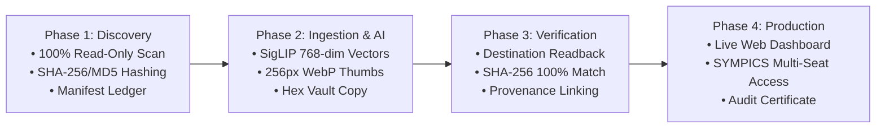

# SYMPICS Enterprise Storage & Data Migration Strategy
## Executive Briefing & Architecture Modernization Roadmap

---

### Executive Summary

As digital media volumes scale beyond **10 Terabytes (10M+ images and video keyframes)**, traditional file management systems—such as storing media in arbitrary folder hierarchies, dates, or nested directories—inevitably fail. Operating systems experience severe performance degradation, network shares time out, duplicate media wastes costly storage, and critical data provenance is compromised.

This document outlines the strategic transition to the **SYMPICS Enterprise Content-Addressable Storage (CAS) Vault & PostgreSQL Vector Architecture**. Designed specifically for high-throughput digital asset management, large-scale media archives, and rapid cross-dataset correlation, this architecture guarantees **zero data loss**, **instant AI similarity searching**, and **cryptographically verifiable data auditability**.

---

### Key Business & Operational Benefits

| Capability | Impact | Technical Foundation |
| :--- | :--- | :--- |
| **Zero Data Loss** | Rigorous readback verification on every byte copied. | SHA-256 pre- and post-copy validation. |
| **30%–60% Disk Savings** | Storage deduplication stores one physical copy per hash. | Content-Addressable Storage (CAS) architecture. |
| **Sub-Second AI Search** | Instant visual and semantic similarity across 10M+ items. | 768-dim SigLIP vectors with PostgreSQL HNSW indexing. |
| **Tamper-Evident Audit** | Cryptographically immutable database ledger for auditability. | Simultaneous SHA-256, MD5, and SHA-1 timestamps. |
| **Sub-MS UI Previews** | 256px WebP thumbs eliminate LAN bandwidth bottlenecks. | Automated high-speed thumbnail caching pipeline. |
| **Air-Gapped Deployment** | 100% on-premises, zero cloud dependency. | Local execution supporting high-throughput CPU and GPU inference. |

---

### The Operational Challenges of Legacy Storage vs. The SYMPICS Solution

| Operational Challenge | Legacy Unstructured Approach | SYMPICS Enterprise CAS & PostgreSQL Solution |
| :--- | :--- | :--- |
| **System Scalability** | Folder crashes, Explorer freezes when opening folders with 50,000+ files. | **65,536 Balanced Hex Buckets:** Never more than ~150 files per folder at 10M scale. |
| **Data Integrity Risk** | Accidental file overwrite, accidental deletion, silent disk corruption. | **Zero Data Loss Guarantee:** Read-only legacy discovery + destination readback hash audit. |
| **Storage Consumption** | Identical images saved across multiple project folders waste terabytes. | **Content-Addressable Deduplication:** Physical media stored once; referenced across datasets. |
| **Search Speed** | Linear scan across millions of files takes hours/days. | **HNSW Vector Search:** Sub-second collision and semantic matching across 10M records. |
| **Data Provenance**| Weak tracking; difficult to prove file authenticity over time. | **Cryptographic Provenance:** SHA-256, MD5, and SHA-1 timestamps permanently recorded. |
| **Network Performance**| Full-resolution 50MB RAW/JPEG downloads choke 10G local networks. | **Fast Previews:** Pre-generated 256px WebP thumbnails load instantaneously in UI. |

---

### The Four-Phase Zero-Risk Migration Lifecycle

1. **Phase 1 — Non-Destructive Discovery:** Scans legacy media in strict read-only mode without moving or renaming a single file. Populates the `migration_manifest` ledger with file sizes, timestamps, and hashes.
2. **Phase 2 — AI Embedding & Vault Copy:** Computes SigLIP 768-dimensional vision embeddings, generates lightweight UI preview thumbnails, and copies files into the two-layer hex vault.
3. **Phase 3 — Cryptographic Readback Verification:** Re-reads the file from the destination disk to verify that `destination_sha256 == source_sha256`. Marks files as `VERIFIED_COPIED` only upon exact cryptographic proof.
4. **Phase 4 — Production Handover & Live Telemetry:** Connects analyst and operator workstations to the master vault with live monitoring via the web dashboard (`http://localhost:8080`).

---

### Conclusion & Next Steps

The SYMPICS Enterprise Data Migration Framework delivers a permanent, hardened foundation that scales effortlessly to 10+ Terabytes while preserving complete data provenance.

To proceed with operational deployment:
1. Initialize the Hex Vault structure on the primary storage network.
2. Deploy the PostgreSQL database and migration manifest ledger.
3. Execute Phase 1 Discovery and Phase 2 Ingestion under real-time dashboard observation.

