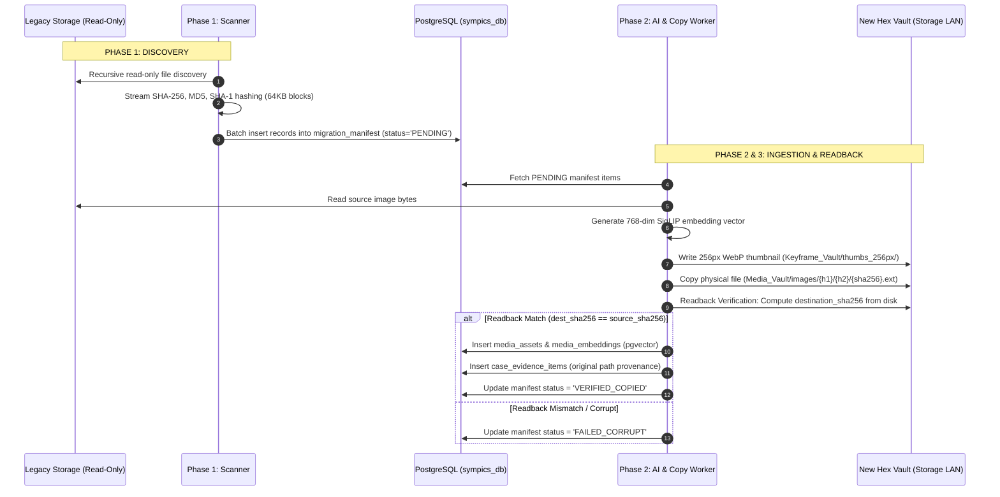

# SYMPICS Four-Phase Data Migration Architecture
## Comprehensive Technical Specification & Operational Runbook

---

### Introduction & Scope

This specification defines the end-to-end technical procedures, data structures, and cryptographic safeguards used to migrate legacy media repositories (10+ Terabytes, 10M+ media items) into the SYMPICS Enterprise Content-Addressable Storage (CAS) Vault and PostgreSQL database.

---

### Core Guarantees

> **Migration Integrity Guarantees:**
> 1. **100% Non-Destructive:** Legacy storage is mounted in strict read-only mode.
> 2. **Repeatable & Idempotent:** Scripts can be re-run safely without creating duplicate files.
> 3. **Data Provenance:** Every original path, filename, and date is preserved in the database.
> 4. **Readback Verification:** Destination bytes are re-hashed and verified before completion.

---

### Phase-by-Phase Technical Breakdown



---

### Phase 1: Read-Only Discovery & Manifest Ledgering

#### Technical Objective:
Traverse legacy file systems, compute 3 cryptographic fingerprints per file, and establish an immutable migration manifest ledger.

* **Tool:** `scripts/filesystem-migration/scan_legacy_manifest.py`
* **Memory Safety:** Hashing uses 64KB chunked streams (`iter(lambda: f.read(65536), b"")`), consuming $<10\text{ MB}$ RAM even for 50GB video containers.
* **Captured Fields:**
  * `source_filepath`: Absolute source path (Unique constraint).
  * `source_filename`: Original file name (e.g. `PHOTO-2024-04-18.jpg`).
  * `source_parent_dir`: Immediate folder name (e.g. `Case_102`).
  * `file_size_bytes`: Byte count on disk.
  * `sha256`, `md5`, `sha1`: Cryptographic checksums.
  * `status`: Initialized to `PENDING`.

```bash
python3 scripts/filesystem-migration/scan_legacy_manifest.py --source-dir /path/to/legacy-storage
```

---

### Phase 2: AI Vector Embedding & Deterministic Hex Vault Copy

#### Technical Objective:
Transform physical files into searchable vector assets and organize them in the 2-layer hex vault.

* **Tool:** `scripts/filesystem-migration/migrate_vault_worker.py`
* **AI Model:** SigLIP (`google/siglip-base-patch16-224`) generating 768-dimensional L2-normalized vectors.
* **Fast Previews:** Pre-computes 256px WebP thumbnails to avoid network lag when analysts browse large galleries.
* **Path Resolution:**
  ```text
  Media File:     01_Media_Vault/images/{sha256[0:2]}/{sha256[2:4]}/{sha256}.jpg
  Thumbnail File: 02_Keyframe_Vault/thumbs_256px/{sha256[0:2]}/{sha256[2:4]}/{sha256}_thumb.webp
  ```

---

### Phase 3: Cryptographic Readback Verification & Deduplication

#### Technical Objective:
Cryptographically prove that every copied file is bit-for-bit identical to the source before marking it complete, while eliminating duplicate storage waste.

* **Verification Handshake:**
  1. File is copied to destination.
  2. Worker re-opens the file from the destination disk and computes `destination_sha256`.
  3. Strict condition: `destination_sha256 == source_sha256` AND `destination_size == source_size`.
* **Automated Deduplication:**
  * If a file with the same SHA-256 is encountered across multiple source folders or datasets, the physical file is stored **only once** in `media_assets`.
  * Every original location and folder name is preserved independently in `case_evidence_items`.

---

### Phase 4: Production Handover & Live Dashboard Monitoring

#### Technical Objective:
Provide real-time visibility into the migration status and integrate with SYMPICS Desktop and Ingestion Studio.

* **Web UI Dashboard:** `database/dashboard.py` running on port `8085`.
* **Real-Time View:** Queries `v_migration_summary` reporting discovered files, verified copies, duplicate savings, and completion percentage.
* **Verification Certificate:** Generates a timestamped JSON manifest certifying the integrity of the completed vault.
