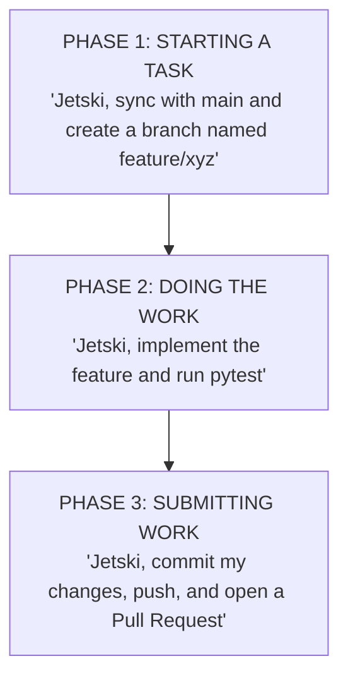

# Git & Repository Operations for Analysts & Engineers
## Standard Operating Procedure (SOP) & Training Manual

---

### Module 1: The Core Philosophy — Why We Use Git

In software engineering and data management, **Git is our immutable audit trail**. It guarantees that:
1. We always maintain a single, uncorrupted **Production Baseline (`main`)**.
2. No individual contributor can accidentally overwrite, delete, or break production code.
3. Every single line of code is cryptographically signed, timestamped, and attributed to an author.

---

### Module 2: The Enterprise Collaboration Model

| Git Concept | Operational Equivalent | What It Does / Why It Matters |
| :--- | :--- | :--- |
| **`main` (or `master`)** | **Official Production Baseline** | The permanent, production-ready source of truth. Unvetted draft changes are never pushed directly to main. |
| **`branch`** | **Isolated Working Copy / Sandbox** | A personal branch where you can test ideas, add features, or refine code without touching production. |
| **`commit`** | **Time-Stamped Milestone** | A saved checkpoint explaining *what* was changed and *why*. |
| **`git pull` / Sync** | **Upstream Synchronization** | Updating your local environment with the latest verified master files before starting work. |
| **`Pull Request (PR)`** | **Peer Review Submission** | Submitting your finished work to peers and leads for review before it gets merged into the official repository. |
| **`CI (Automated Tests)`** | **Automated Gatekeeper** | Automated digital test runner that checks for syntax errors, broken tests, and blocks accidental data/secret commits. |
| **`Merge`** | **Approved Production Integration** | Incorporating the approved changes permanently into the master branch. |

---

### Module 3: The Three Golden Rules of the Repository

> **The 3 Golden Repository Rules:**
> 1. **Never Write Directly to Main:** Always do work on a separate feature branch (e.g., `feature/new-filter`).
> 2. **Zero Media / Zero Spreadsheets / Zero Secrets:** Git tracks code and documentation only. Never commit images, raw media, videos, Excel/CSV files, or API credentials to the repository.
> 3. **All Changes Merge via Pull Request (PR):** Nothing enters the master file without an approved Pull Request and a green CI test checkmark.

---

### Module 4: Operating via Jetski Web (No Command-Line Required)

Because you are using **Jetski Web**, you never have to type complex terminal commands. You simply prompt Jetski using three standard phrases:

#### Step 1: Starting Any New Task
Before touching code, give Jetski this exact prompt:
> *"Jetski, please make sure my repository is updated with the latest `main` branch, and create a new working branch called `feature/<your-topic>`."*

#### Step 2: Testing Before Submitting
Once your edits are made, give Jetski this quality check prompt:
> *"Jetski, run `pytest tests/` to verify all tests pass and ensure no media files or secrets are staged."*

#### Step 3: Submitting for Review
When ready for review and merge:
> *"Jetski, commit my changes with a clear summary, push my branch to GitHub, and give me the link to open a Pull Request for Eric."*

---

### Module 5: Understanding the Pull Request (PR) Lifecycle

When you open a Pull Request on GitHub:

1. **The Automated Gatekeeper (CI) Runs Automatically:**
   * It spins up an isolated test container.
   * It verifies that **ZERO** media files (`.jpg`, `.png`, `.cr3`) or tabular data (`.csv`, `.xlsx`) were included.
   * It executes all 25 system tests.
2. **Review & Approval:**
   * Your collaborator reviews the diff (green additions, red removals).
   * Once approved, the **"Merge Pull Request"** button is clicked.
3. **Branch Cleanup:**
   * The feature branch is automatically deleted, and the master file is now updated for everyone.

---

### Quick Reference / Cheat Sheet for Daily Work

* **Start of Day / New Task:** Tell Jetski: *"Sync with main and create a new feature branch."*
* **During Work:** Make edits, test in the Web UI.
* **End of Task:** Tell Jetski: *"Run tests, commit, push, and create a Pull Request."*
* **Questions / Issues:** If in doubt, ask before merging!
